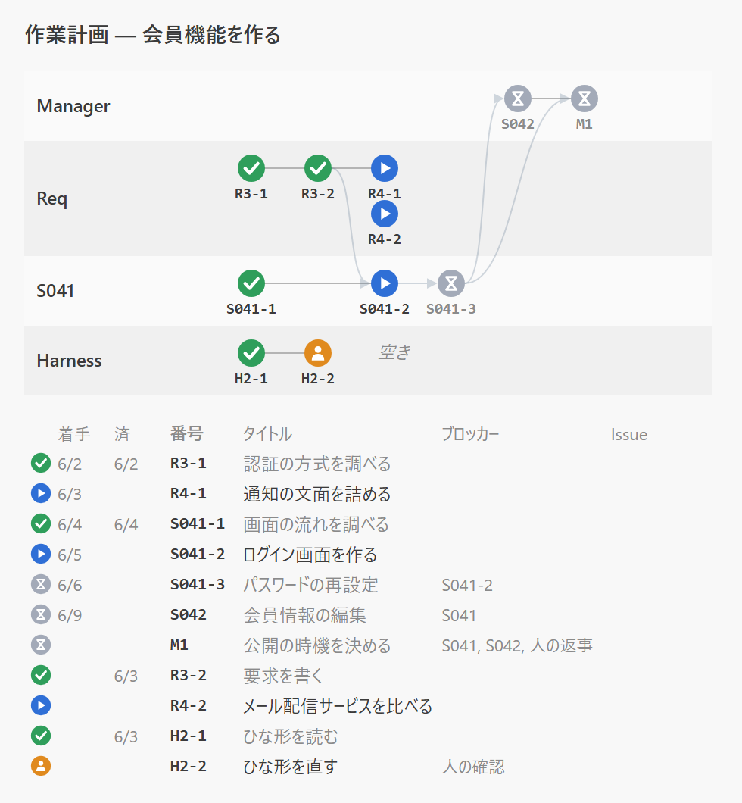

# my-claude-toolkit

Claude Code での開発に使っている、個人的な便利ツールの置き場所。

> **English summary**: A small toolkit for developing with [Claude Code](https://claude.com/claude-code).
> Its first tool, **teamkit**, lets you run several Claude Code sessions as a team (a manager, departments and work lines).
> Each session keeps its tasks in a `TASK.md`; a single Python script (standard library only) walks the `TASK.md` tree to show the overall picture, the plan (free / ready / waiting for a human / blocked) and a lane diagram.
> Skills are included for overview, planning, handover (resume after `/clear`), starting a line and closing a sprint.
> The documents are written in Japanese. See [teamkit/README.md](teamkit/README.md).

## 技術スタック

- Python 3.9 以上（標準ライブラリだけ。pip で入れるものはない）
- Claude Code のスキル（`.claude/skills/`）
- git（`gh` はあれば一部で使う）

## ツール

| ツール | 何をするか | 説明 |
| :--- | :--- | :--- |
| teamkit | Claude Code のセッションをチームにして開発するための部品・決まり・ひな形と、それを使うスキル | [teamkit/README.md](teamkit/README.md) |

ツールは今後も適宜追加予定。

## ライセンス

MIT（[LICENSE](LICENSE)）
